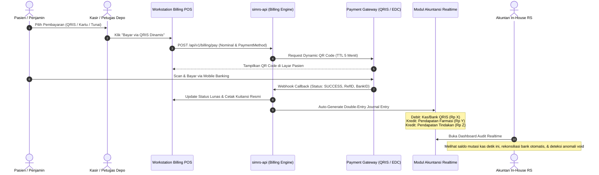

# PELAN IMPLEMENTASI: ARSITEKTUR ROLE-BASED DYNAMIC WORKSTATIONS (SIMRS ENTERPRISE)

> **Dokumen Strategis & Teknis Pengembangan SIMRS Terintegrasi**  
> **Status:** Disetujui & Diperluas (Approved for Execution - Master Enterprise Scope)  
> **Target Pengguna:** Manajemen Rumah Sakit, Komite Medik, Komite Mutu, Kepala IPSRS/Sanitasi, dan Tim Engineering SIMRS  
> **Kepatuhan Regulasi:** UU Pelindungan Data Pribadi (UU PDP No. 27/2022), Permenkes No. 24/2022 (RME), Permenkes No. 40/2022 (IPSRS & Alkes), Permen LHK No. P.80/2019 (SPARING IPAL), Standar Akreditasi STARKES/KARS  

---

## 1. Latar Belakang & Filosofi Desain

### 1.1 Masalah pada SIMRS Konvensional (*Monolithic All-in-One Dashboard*)
Di sebagian besar rumah sakit yang mengadopsi sistem informasi satu layar (*all-in-one UI*), seluruh role pengguna (Dokter, Apoteker, Kasir, Perawat, Manajemen, hingga Teknisi Utility) dihadapkan pada antarmuka yang bercampur aduk. Pendekatan ini terbukti menimbulkan kendala operasional serius:
1. **Beban Kognitif Tinggi (*Information Clutter*)**: Di jam sibuk dengan antrean puluhan pasien per poli, dokter hanya memiliki waktu 3–5 menit per pasien. Melihat menu billing kasir, tempat tidur bangsal, atau outbox teknis sangat memperlambat dokter.
2. **Risiko Kebocoran Data Medis (*Data Privacy & Need-to-Know*)**: Sesuai UU PDP No. 27/2022, petugas administrasi kasir atau teknisi IPSRS tidak berhak melihat riwayat catatan medis/SOAP kejiwaan atau organ reproduksi pasien. Sebaliknya, dokter tidak berkepentingan menginspeksi mutasi kas dan pembukuan finansial harian.
3. **Pemisahan Buta antara Layanan Klinis dan Fasilitas Fisik (IPSRS Silo)**: Seringkali insiden klinis (misal operasi tertunda karena tekanan gas $O_2$ drop, ventilator belum terkalibrasi BPFK, atau saluran dapur tersumbat grease trap) terjadi karena ketiadaan jembatan telemetri antara instalasi pemeliharaan fasilitas (IPSRS) dengan sistem inti rumah sakit.

### 1.2 Solusi: *Gate at Login* (Zero-Client Setup, User-Driven Workstation)
Arsitektur **Role-Based Dynamic Workstation** menerapkan gerbang di tingkat **Autentikasi Pengguna (Login Gate)**:
* **Komputer manapun dapat digunakan** (fleksibel, aman, web-based).
* Begitu pengguna memasukkan kredensial, token JWT mendekodekan atribut `role`, `unit`, dan `authorized_workstations`.
* Sistem secara dinamis memuat workstation khusus departemen tersebut secara otomatis, bersih, dan tanpa tombol/informasi asing yang tidak relevan.

---

## 2. Matriks Terpadu 14 Workstation Rumah Sakit Modern

```
                                  ┌─────────────────────────────┐
                                  │   LOGIN UNIFIED SIMRS       │
                                  │   (SSO + Role Detection)    │
                                  └──────────────┬──────────────┘
                                                 │
      ┌───────────────────────────┬──────────────┴──────────────┬───────────────────────────┐
      ▼                           ▼                             ▼                           ▼
[ CLUSTER KLINIS ]      [ CLUSTER KEUANGAN & ADM ]   [ CLUSTER MANAJEMEN/SDM ]     [ CLUSTER FASILITAS & IPSRS ]
• WS-01: Poli Dokter    • WS-03: Admisi & Loket      • WS-05: Executive Direksi    • WS-08: IPSRS & Alkes (ATEM)
• WS-02: Depo Farmasi   • WS-04: Kasir, Billing &    • WS-06: SDM & Kredensial     • WS-09: Sanitasi & IPAL (IoT)
                                 Akuntansi In-House  • WS-07: IT & IAM Security    • WS-10: Gas Medis & Utility
                                                                                   • WS-11: Dapur & Gizi Pasien
                                                                                   • WS-12: CSSD & Laundry Linen
                                                                                   • WS-13: Armada Ambulans
                                                                                   • WS-14: Parkir & Keamanan
```

---

### Cluster A: Layanan Medis & Klinis

#### Workstation 1: Dokter Spesialis & Poliklinik (`/workspace/clinic`)
* **Pengguna**: Dokter Penanggung Jawab Pelayanan (DPJP) & Asisten Dokter.
* **Fitur Utama**:
  * **Antrean Pasien Spesifik Poli**: Hanya menyaring pasien yang dijadwalkan ke poliklinik yang bersangkutan hari ini.
  * **Kanvas Spesialisasi Klinis Khusus**:
    * **Poli Gigi & Mulut**: Diagram interaktif **Odontogram 32 Gigi** (karies, tambalan, akar, mahkota, missing tooth).
    * **Poli Saraf**: Skoring otomatis Glasgow Coma Scale (GCS) dan skoring stroke NIHSS.
    * **Poli Anak**: Kurva pertumbuhan terstandar WHO/CDC (Berat/Tinggi/Lingkar Kepala) dan pelacak jadwal imunisasi.
    * **Poli Mata**: Skema refraksi, visus mata kanan (OD) & mata kiri (OS), serta tekanan intraokular (TIO).
  * **E-Prescribing Terintegrasi**: Pilihan obat KFA Kemenkes dengan indikator real-time stok depo dan status dispensing farmasi (*Menunggu* ➔ *Selesai Diserahkan*).
  * **Order Penunjang Otomatis (IHE RAD-4)**: Order Radiologi & Lab dengan penomoran Accession Number otomatis ke RIS & PACS.

#### Workstation 2: Farmasi & Gudang Obat (`/workspace/pharmacy`)
* **Pengguna**: Apoteker, Asisten Apoteker (Tenaga Teknis Kefarmasian).
* **Fitur Utama**:
  * **Worklist Telaah Resep Kemenkes**:
    * *Kajian Administratif* (kelengkapan identitas pasien & dokter).
    * *Kajian Farmasetik* (bentuk sediaan, dosis, potensi, inkompatibilitas).
    * *Kajian Klinis* (deteksi otomatis alergi obat, duplikasi terapi, interaksi obat berbahaya).
  * **Dispensing Pipeline**: Status antrean visual: *Menunggu Telaah* ➔ *Proses Racik/Ambil* ➔ *Panggil Pasien* ➔ *Selesai Diserahkan*.
  * **Manajemen Stok Real-Time Depo Farmasi**: Metode FEFO (*First Expired, First Out*) dan FIFO, alert otomatis obat *fast-moving* menipis.
  * **Cetak Etiket Otomatis**: Integrasi printer label thermal dengan barcode verifikasi penyerahan 5 Benar Obat.
  * **Mini-POS Satelit**: Opsi pelunasan langsung untuk pasien rawat jalan non-tindakan menggunakan QRIS Dinamis & EDC.

---

### Cluster B: Administrasi, Keuangan & Akuntansi

#### Workstation 3: Admisi & Loket Registrasi Pasien (`/workspace/admission`)
* **Pengguna**: Petugas Admisi & Registrasi Rawat Jalan, IGD, dan Rawat Inap.
* **Fitur Utama**:
  * **Master Patient Index (EMPI) 5-Parameter Search**: Pencarian multi-parameter instan via Nama, NIK KTP (16 digit), No. HP/WhatsApp, Nama Ibu Kandung, dan No. RM.
  * **Bridging BPJS VClaim & P-Care**: Validasi rujukan faskes tingkat pertama online secara real-time.
  * **Penerbitan SEP Otomatis**: Generate Surat Eligibilitas Peserta BPJS dalam satu klik.
  * **Cetak Gelang Pasien & Kartu Berobat**: Cetak gelang identifikasi pasien standar keselamatan pasien (KARS).

#### Workstation 4: Kasir, Billing & Akuntansi In-House (`/workspace/billing`)
* **Pengguna**: Kasir Rumah Sakit, Verifikator Klaim Asuransi, Auditor/Akuntan In-House.
* **Fitur Utama**:
  * **POS Billing Terintegrasi (Single-Bill)**: Konsolidasi otomatis tagihan poliklinik, tindakan kamar bedah, radiologi, lab, dan farmasi tanpa entri manual ganda.
  * **Multi-Payment Gateway Realtime**:
    * Pembayaran Tunai dengan verifikasi uang kembalian.
    * EDC Debit / Kartu Kredit via settlement terintegrasi.
    * **QRIS Dinamis (MPM/CPM)**: Generate QR unik per transaksi dengan TTL 5 menit; webhook callback mengonfirmasi lunas otomatis tanpa input manual kasir.
  * **Automated General Ledger & Journal Entries (Akuntansi Realtime)**:
    * Setiap transaksi lunas otomatis meng-generate jurnal akuntansi double-entry (Debit: Kas/Bank/Piutang BPJS vs Kredit: Pendapatan Farmasi/Tindakan/PPn).
    * Modul rekonsiliasi bank otomatis (*bank auto-reconciliation*).
    * Penutupan Kasir per Shift (Z-Report) untuk mencegah *cash leakage* (kebocoran kas fisik).
    * Laporan real-time: Buku Besar (*General Ledger*), Neraca (*Balance Sheet*), Laporan Laba Rugi (*P&L*), dan Arus Kas harian.
  * **Grouping Awal INA-CBG**: Estimasi klaim BPJS untuk kendali mutu dan biaya (*cost containment*).

---

### Cluster C: Manajemen Eksekutif, SDM & IT

#### Workstation 5: Direksi & Manajemen Eksekutif (`/workspace/executive`)
* **Pengguna**: Direktur Utama, Direktur Medis, Direktur Keuangan & Operasional.
* **Fitur Utama**:
  * **Indikator Efisiensi Rawat Inap (Grafik Barber-Johnson)**:
    * **BOR** (*Bed Occupancy Rate*) target 60–85%.
    * **ALOS** (*Average Length of Stay*) target 3–6 hari.
    * **TOI** (*Turn Over Interval*) jeda tempat tidur kosong.
    * **BTO** (*Bed Turn Over*) & **NDR/GDR** (angka kematian rumah sakit).
  * **Financial Real-Time Dashboard**: Pendapatan harian bersih, rasio Pasien BPJS vs Umum vs Asuransi, saldo piutang klaim dan umur piutang (*aging accounts receivable*).
  * **Service Level Agreement (SLA) Waktu Tunggu**: Durasi rata-rata pasien di loket admisi, poli dokter, farmasi racikan, dan radiologi.

#### Workstation 6: SDM, HRD & Kredensial Tenaga Medis (`/workspace/hrd`)
* **Pengguna**: Manajer SDM, Komite Medik, Komite Keperawatan.
* **Fitur Utama**:
  * **Early Warning System STR & SIP**: Notifikasi otomatis H-60 dan H-30 sebelum masa berlaku STR dan SIP dokter/perawat kedaluwarsa.
  * **Buku Putih & Rincian Kewenangan Klinis (RKK / SPK)**: Database kewenangan tindakan tiap staf medis sesuai kompetensi.
  * **Manajemen Roster & Jadwal Jaga**: Penjadwalan dokter jaga IGD, dokter on-call spesialis, dan perawat ruangan.

#### Workstation 7: Administrator IT & IAM Console (`/workspace/admin`)
* **Pengguna**: Tim SIMRS & IT Security Rumah Sakit.
* **Fitur Utama**:
  * **User Management & RBAC Provisioning**: Pembuatan akun dengan penugasan poliklinik dan peran yang ketat.
  * **Audit Log Trail Interaktif**: Rekam jejak seluruh mutasi rekam medis (siapa mengakses, mengedit, atau menghapus data pasien).
  * **Bridging Health Telemetry**: Pemantauan antrean HL7 MLLP ke RIS/PACS dan SATUSEHAT FHIR outbox sync.

---

### Cluster D: IPSRS, Utility & Fasilitas Penunjang Non-Klinis

#### Workstation 8: IPSRS & Elektromedik / ATEM (`/workspace/ipsrs`)
* **Pengguna**: Tenaga Elektromedis (ATEM), Teknisi Elektromedik, Kepala IPSRS.
* **Kepatuhan Regulasi**: Permenkes No. 40/2022 tentang Pengujian dan Kalibrasi Alat Kesehatan.
* **Fitur Utama**:
  * **Master Inventaris Aset Alkes Berbasis Barcode/RFID**:
    * Pencatatan lengkap merk, model, nomor seri, tanggal perolehan, distributor, dan lokasi penempatan fisik mesin.
    * Klasifikasi risiko alkes (Resiko Tinggi: Ventilator, Defibrillator, Anestesi; Resiko Sedang: USG, X-Ray, Infusion Pump; Resiko Rendah: Timbangan, Tensimeter).
  * **Manajemen Kalibrasi Berkala BPFK**:
    * Peringatan jatuh tempo kalibrasi otomatis (H-60, H-30).
    * Unggah sertifikat kalibrasi resmi dari BPFK (Balai Pengamanan Fasilitas Kesehatan) atau instansi penguji berizin.
    * Status operasional instrumen: *Laik Pakai*, *Perlu Kalibrasi Ulang*, atau *Afkir / Karantina*.
  * **Tiket Kerusakan & Work Order (CMMS - Computerized Maintenance Management System)**:
    * Perawat atau dokter dapat membuat tiket kerusakan alat medis langsung dari workstation poli/bangsal.
    * Pelacakan metrik keandalan mesin: **MTTR** (*Mean Time to Repair*) dan **MTBF** (*Mean Time Between Failures*).
    * Log penggantian suku cadang (*spare parts inventory*).

#### Workstation 9: Sanitasi Lingkungan & IPAL Terpadu (`/workspace/sanitation`)
* **Pengguna**: Tenaga Sanitasi Lingkungan (Sanitarian), Teknisi IPAL, Tim K3RS.
* **Kepatuhan Regulasi**: Permen LHK No. P.80/2019 (SPARING - Sistem Pemantauan Kualitas Air Limbah Terus Menerus) & Permenkes Standar Baku Mutu Kesehatan Lingkungan RS.
* **Fitur Utama**:
  * **Solusi Pintar Grease Trap Dapur RS (Pencegah Sumbatan & Kerusakan IPAL)**:
    * *Latar Belakang*: Limbah dapur mengandung konsentrasi FOG (*Fats, Oils, and Grease*) sangat tinggi. Bila membeku, pipa saluran limbah tersumbat fatal, menimbulkan bau busuk di ruang rawat, dan meracuni bakteri pengurai aerob di reaktor biologis IPAL.
    * *Sensor Ketebalan Lapisan Lemak (Ultrasonic / Capacitive Interface Level)*: Memantau ketebalan lapisan FOG terapung secara non-kontak. Memicu alert *Early Warning Skimming* otomatis saat ketebalan lemak mencapai $\ge 25\%$ volume kerja perangkap.
    * *Sensor Overflow & Suhu (Float Switch Anti-Clog)*: Mendeteksi kenaikan level air di atas batas normal jika pipa pembuangan mulai terhambat.
    * *Automated Bio-Enzyme Dosing System*: Integrasi sinyal kontrol dengan pompa peristaltik dosing bio-enzim pengurai lemak yang aktif otomatis di luar jam operasional dapur (misal pk 23:00) untuk mencerna sisa minyak di dinding pipa.
  * **Telemetri Realtime IPAL (Integrasi SPARING KLHK)**:
    * Probe sensor online 24/7 di bak outlet akhir:
      * **pH Sensor** (rentang aman 6.0 – 9.0).
      * **Dissolved Oxygen (DO)** pada kolam aerasi ($> 2.0$ mg/L untuk menjamin kelangsungan hidup biomassa aerob).
      * **TSS** (*Total Suspended Solids*) & **COD / BOD** online analyzer.
      * **Flow Meter Digital** (pencatatan debit air limbah harian dalam $m^3$/hari).
    * Peringatan dini (*early warning SMS/Telegram/Push Notification*) sebelum limbah dibuang ke badan air penerima lingkungan.
  * **Manajemen Limbah Medis B3 (Festronik KLHK)**:
    * Pencatatan timbangan limbah medis per ruangan (Spuit/Jarum, Kasa Darah, Jaringan Patologi, Farmasi Kedaluwarsa).
    * Pemantauan suhu cold storage penyimpanan limbah B3 medis ($< 0^\circ$C bila disimpan $> 48$ jam).
    * Integrasi manifes elektronik pengangkutan limbah B3 pihak ketiga resmi (*Festronik KLHK*).

#### Workstation 10: Central Gas Medis & Power Utility (`/workspace/utility`)
* **Pengguna**: Teknisi Instalasi Gas Medis, Teknisi Listrik/MEP, Petugas Boiler & HVAC.
* **Kepatuhan Regulasi**: Permenkes No. 4/2016 tentang Penggunaan Gas Medik dan Oksigen Generator.
* **Fitur Utama**:
  * **Manifold Tekanan Gas Medis Sentral**:
    * Sensor tekanan digital pipa gas utama: Oksigen ($O_2$), Nitrous Oxide ($N_2O$), Udara Tekan Medis (Medical Air 4 bar & 7 bar), dan Sistem Vakum Medis (*Medical Suction*).
    * Peringatan audio-visual instan di workstation bila tekanan berada di bawah ambang batas kritis (indikasi kebocoran pipa atau suplai habis).
  * **Manajemen Cadangan Tabung Oksigen (Buffer Stock)**:
    * Pelacakan stok tangki oksigen cair (*Liquid Oxygen Cryogenic Tank*) dan bank manifold tabung cadangan (*standby cylinder rack*).
    * Prediksi waktu kehabisan (*Burn-Rate Predictive Analytics*) berbasis laju konsumsi aktual di IGD, ICU, dan Kamar Bedah.
  * **Monitoring HVAC Tata Udara & Filter HEPA**:
    * Pemantauan perbedaan tekanan ruang (*Differential Pressure Sensor*):
      * **Tekanan Positif**: Kamar Operasi (OK) dan Ruang Bersih Farmasi Steril (mencegah patogen masuk dari koridor luar).
      * **Tekanan Negatif**: Ruang Isolasi TB / Airborne Infection (mencegah aerosol infeksius bocor ke koridor umum).
    * Kontrol parameter kritis: Suhu ($19–24^\circ$C), Kelembaban Relatif (RH 45–60%), dan indikator penurunan tekanan filter HEPA (*dirty filter warning*).
  * **Genset Otomatis (ATS) & UPS Critical Care**:
    * Status kesiapan Genset Darurat (Level Solar, Tegangan Starter Aki, Jam Operasional).
    * Automatic Transfer Switch (ATS) log: Memastikan jeda mati lampu hingga suplai genset $< 10$ detik (standar KARS).
    * Kapasitas baterai UPS khusus Kamar Bedah, ICU, dan Data Center.

#### Workstation 11: Dapur & Instalasi Gizi Pasien (`/workspace/nutrition`)
* **Pengguna**: Ahli Gizi (Dietisien), Petugas Juru Masak Dapur, Staf Distribusi Makanan.
* **Fitur Utama**:
  * **Sinkronisasi Otomatis CPPT DPJP ke Diet Dashboard**:
    * Setiap kali dokter menetapkan preskripsi diet pada RME (misal: *Diet Rendah Garam II*, *Diet Lambung*, *Diet DM 1700 kkal*, atau *Sonde Cair Peptamen*), pesanan otomatis masuk ke jadwal produksi dapur tanpa kurir kertas.
  * **Papan Produksi Makanan & Porsi Harian**:
    * Agregasi kebutuhan logistik bahan baku dapur untuk sesi Makan Pagi, Snack Pagi, Makan Siang, Snack Sore, dan Makan Malam.
    * Peringatan alergi makanan spesifik pasien (misal: Alergi Seafood, Intoleransi Laktosa, Alergi Kacang).
  * **Cetak Etiket Nampan Makanan (Label Tray Barcode)**:
    * Label etiket bersih tahan uap memuat Nama Pasien, No RM, Bed/Ruangan, Jenis Diet, Tanggal/Jam Penyajian, dan Barcode verifikasi serah terima.
  * **HACCP & Monitoring Suhu Penyajian**:
    * Pencatatan suhu makanan saat selesai dimasak dan saat tiba di bangsal pasien ($> 60^\circ$C untuk makanan panas guna mencegah kontaminasi bakteri makanan).

#### Workstation 12: CSSD (Sterilisasi Sentral) & Linen Laundry (`/workspace/logistics`)
* **Pengguna**: Petugas CSSD (*Central Sterile Supply Department*), Petugas Instalasi Laundry.
* **Fitur Utama**:
  * **Pelacakan Siklus Sterilisasi Instrumen Bedah (Surgical Tray Tracking)**:
    * Penerimaan instrumen kotor pasca operasi ➔ Proses Dekontaminasi & Pencucian Enzimatik ➔ Pengemasan & Pemberian Label Indikator ➔ Pemuatan ke Mesin Autoclave Steam / Plasma Sterilizer.
    * Pencatatan nomor lot siklus sterilisasi, grafik suhu/tekanan/durasi mesin, serta hasil uji indikator biologi (*Geobacillus stearothermophilus*) dan kimia.
    * Penyerahan set instrumen steril ke Kamar Bedah dengan scan barcode.
  * **Manajemen Linen & Laundry Rumah Sakit**:
    * Pemisahan ketat alur Linen Infeksius (kantong kuning terkontaminasi darah/cairan tubuh) vs Linen Non-Infeksius.
    * Standar pencucian termal (suhu air desinfeksi $70–80^\circ$C dengan bahan kimia klorin terukur).
    * Kontrol inventaris sprei, selimut, baju operasi, dan handuk per bangsal untuk meminimalkan kehilangan (*linen loss prevention*).

#### Workstation 13: Armada Ambulans & Transport Medis (`/workspace/fleet`)
* **Pengguna**: Koordinator Ambulans, Pengemudi, Perawat Tim Transport Medis.
* **Fitur Utama**:
  * **Checklist Kesiapan Ambulans Emergency**:
    * Verifikasi berkala harian sebelum bertugas: Isi tabung $O_2$ portabel, daya baterai AED/Defibrillator, kesiapan ventilator transport, suction pump, dan kotak obat resusitasi darurat.
  * **Integrasi Rujukan Sisrute Kemenkes**:
    * Sinkronisasi data rujukan gawat darurat antar-faskes dengan platform Sisrute Kemenkes.
  * **Fleet Telematics & Logbook**:
    * Pelacakan posisi GPS armada, estimasi waktu tiba (*ETA*), catatan kilometer servis berkala, dan konsumsi BBM armada.

#### Workstation 14: Parkir & Pengamanan Fisik Terpadu (`/workspace/parking`)
* **Pengguna**: Operator Parkir, Komandan Keamanan / Security RS.
* **Fitur Utama**:
  * **Integrasi Barrier Gate dengan Billing SIMRS**:
    * Validasi tiket parkir barcode saat pasien rawat inap keluar (gratis/diskon tarif parkir otomatis sesuai hak kamar perawatan).
    * Tarif parkir terpusat bagi pengunjung umum dengan dukungan uang elektronik (e-money) & QRIS.
  * **Manajemen Akses Pintu Elektronik & Keamanan Terpadu**:
    * Log otorisasi akses RFID ke ruangan berisiko tinggi (Kamar Bayi/Perinatologi untuk mencegah penculikan bayi, Ruang Jenazah, Gudang Narkotika Farmasi, dan Panel Gardu Listrik).
    * Dashboard pantau kamera CCTV titik-titik vital rumah sakit.

---

## 3. Desain Arsitektur Teknis

### 3.1 Skema Routing Next.js Terpadu
```
src/app/
├── login/
│   └── page.tsx                 # Unified Gateway Login (SSO + Role Detection)
├── workspace/
│   ├── clinic/                  # WS-01: Workstation Dokter Poliklinik
│   │   ├── page.tsx
│   │   └── components/
│   │       ├── OdontogramCanvas.tsx
│   │       ├── GrowthChartChild.tsx
│   │       └── NeuroScore.tsx
│   ├── pharmacy/                # WS-02: Workstation Farmasi & Depo Obat
│   │   └── page.tsx
│   ├── admission/               # WS-03: Workstation Admisi & Registrasi
│   │   └── page.tsx
│   ├── billing/                 # WS-04: Workstation Kasir & Akuntansi In-House
│   │   └── page.tsx
│   ├── executive/               # WS-05: Workstation Direksi RS
│   │   └── page.tsx
│   ├── hrd/                     # WS-06: Workstation SDM & Kredensial Medis
│   │   └── page.tsx
│   ├── admin/                   # WS-07: Workstation IT & IAM Console
│   │   └── page.tsx
│   ├── ipsrs/                   # WS-08: Workstation Elektromedik & Alkes
│   │   └── page.tsx
│   ├── sanitation/              # WS-09: Workstation IPAL & Sensor Grease Trap (IoT)
│   │   └── page.tsx
│   ├── utility/                 # WS-10: Workstation Gas Medis & Power Utility
│   │   └── page.tsx
│   ├── nutrition/               # WS-11: Workstation Dapur & Instalasi Gizi
│   │   └── page.tsx
│   ├── logistics/               # WS-12: Workstation CSSD & Linen Laundry
│   │   └── page.tsx
│   ├── fleet/                   # WS-13: Workstation Armada Ambulans
│   │   └── page.tsx
│   └── parking/                 # WS-14: Workstation Parkir & Pengamanan Fisik
│       └── page.tsx
└── api/                         # Backend Microservices Proxies
```

### 3.2 Alur Akuntansi Terpadu & Audit Realtime (Cashier to General Ledger)


---

## 4. Rencana Kerja Bertahap (Phased Roadmap)

| Fase | Durasi | Sasaran & Deliverable Utama | Status |
| :--- | :--- | :--- | :--- |
| **Fase 1: Gateway & Middleware Routing** | Minggu 1 | Implementasi Next.js middleware untuk auto-redirect berdasarkan token JWT payload, pemisahan role klinis vs kasir, dan sinkronisasi status dispensing resep secara live. | **SELESAI (100%)** |
| **Fase 2: Poliklinik Specialty Workstation** | Minggu 2 | Pemisahan canvas dokter per spesialisasi: Odontogram interaktif 32 gigi untuk Poli Gigi, skoring stroke NIHSS/GCS untuk Poli Saraf, dan kurva WHO untuk Anak. | *Siap Dikerjakan* |
| **Fase 3: Farmasi, Billing & Akuntansi Terpadu** | Minggu 3 | Workstation terisolasi untuk telaah resep farmasi, kasir POS terintegrasi, integrasi QRIS/EDC, serta modul audit akuntansi realtime bagi akuntan in-house. | *Pending* |
| **Fase 4: Executive Command Center** | Minggu 4 | Visualisasi metrik rumah sakit: BOR, ALOS, TOI, komparasi pendapatan harian, dan SLA waktu tunggu seluruh departemen. | *Pending* |
| **Fase 5: Pengujian Terpadu & Simulasi** | Minggu 5 | Validasi zero-clutter di seluruh akun pengujian, audit keamanan UU PDP, dan pelatihan per departemen. | *Pending* |
| **Fase 6: IPSRS, Sanitasi Lingkungan & Utility Suite** | Minggu 6 | Integrasi sensor IoT IPAL (SPARING KLHK), alarm ultrasonik Grease Trap dapur RS, telemetri gas medis sentral, manajemen kalibrasi BPFK alkes, dan pelacak limbah B3 Festronik. | *Master Scope Baru* |
| **Fase 7: Fasilitas Pendukung (Gizi, CSSD, Armada, Parkir)** | Minggu 7 | Implementasi etiket diet nampan dapur gizi, pelacakan siklus autoclave steril CSSD, checklist ambulans gawat darurat, dan barrier gate parkir terpadu. | *Master Scope Baru* |

---

## 5. Ringkasan Nilai Bisnis untuk Manajemen Rumah Sakit

1. **Efisiensi Kerja Maksimal & Nol Distraksi**: Dokter, apoteker, dan teknisi fasilitas tidak lagi terbebani puluhan menu asing di luar tugas pokok fungsinya.
2. **Kepatuhan Audit Hukum Tertinggi**: Memenuhi klausul *Security by Default* & *Privacy by Design* pada UU PDP No. 27/2022, standar RME Permenkes 24/2022, standar akreditasi KARS, serta regulasi lingkungan hidup Permen LHK No. P.80/2019 (SPARING).
3. **Pencegahan Risiko Fatal Fasilitas (*Zero Operational Shutdown*)**: 
   - Deteksi dini penumpukan lemak pada *grease trap* dapur sebelum pipa pembuangan meluap atau bakteri aerob IPAL terbunuh.
   - Peringatan dini sebelum tabung gas medis dan oksigen cair di manifold sentral mencapai tingkat kritis.
   - Jaminan kalibrasi berkala alkes BPFK untuk keselamatan pasien (*patient safety*).
4. **Transparansi Finansial Realtime Tanpa Kebocoran Kas**: Akuntan in-house dapat mengaudit setiap rupiah yang masuk secara instan dari seluruh loket kasir maupun depo satelit tanpa harus menunggu rekonsiliasi manual akhir bulan.
